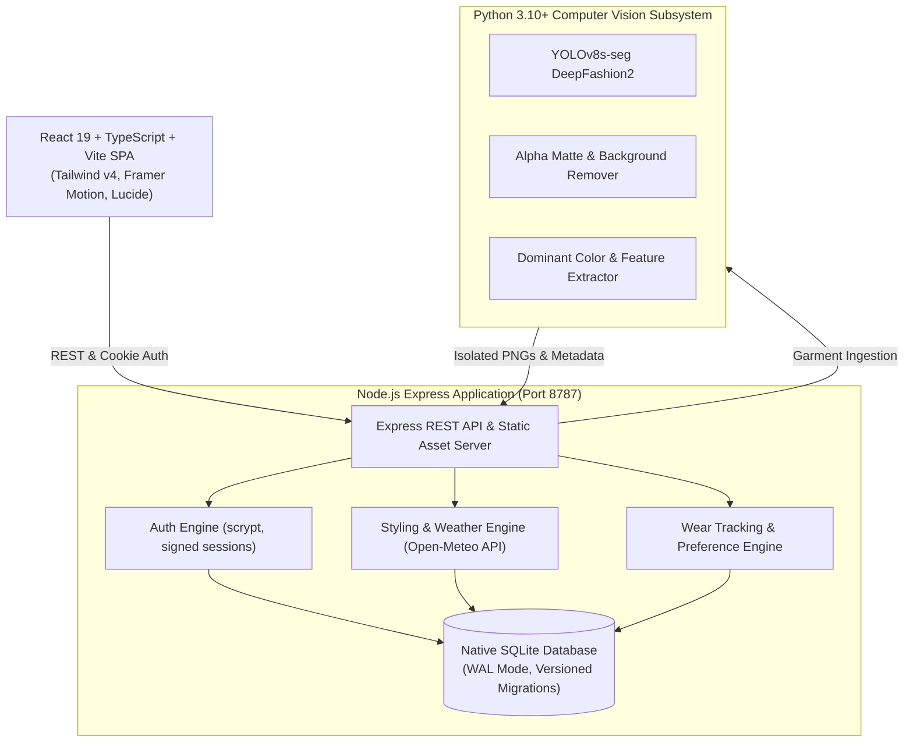

# MAEVE — AI-Based Smart Wardrobe & Weather-Aware Outfit Recommendation System

> *"Your wardrobe. Intelligently styled."*

[](server/test)
[](scripts/verify_persistence_recovery.mjs)
[](https://nodejs.org/)
[](https://react.dev/)
[](https://www.typescriptlang.org/)
[](https://tailwindcss.com/)
[](server/cv)
[](LICENSE)

MAEVE is an AI-powered smart wardrobe operating system and hyper-personalized fashion stylist. Combining DeepFashion2 computer vision segmentation, real-time meteorological intelligence from Open-Meteo, chromatic color theory, and Bayesian preference modeling, MAEVE digitizes your physical wardrobe and delivers editorial-grade, weather-adapted outfit curations tailored to your personal aesthetic.

---

## Table of Contents

- [Key Capabilities](#key-capabilities)
- [System Architecture](#system-architecture)
- [Technology Stack](#technology-stack)
- [Getting Started](#getting-started)
  - [Prerequisites](#prerequisites)
  - [Local Installation](#local-installation)
  - [Running Development Environment](#running-development-environment)
- [Docker Deployment](#docker-deployment)
- [Computer Vision Pipeline](#computer-vision-pipeline)
- [Outfit Recommendation Engine](#outfit-recommendation-engine)
- [Database Persistence & Backup](#database-persistence--backup)
- [Testing & Quality Assurance](#testing--quality-assurance)
- [Environment Configuration](#environment-configuration)
- [API Reference](#api-reference)
- [Contributing](#contributing)
- [License](#license)

---

## Key Capabilities

### 1. Computer Vision & Garment Digitization
- **YOLOv8s-seg DeepFashion2 Model**: Object detection and polygon instance segmentation specialized in garment silhouettes.
- **Automated Background Removal**: Isolates garments from noisy bedroom/closet photos, creating studio-quality transparent PNG cutouts.
- **Color & Palette Extraction**: Quantizes dominant hex colors, saturation, and luminance to index exact chromatic shades.
- **Smart Attribute Inference**: Automatically infers garment category (tops, bottoms, outerwear, footwear, accessories), subcategory, season profile, and thermal warmth rating.

### 2. Live Weather-Aware Styling
- **Real-Time Meteorological Sync**: Ingests temperature, "feels-like" wind chill, precipitation probability, humidity, and UV index via Open-Meteo.
- **Dynamic Thermal Layering**: Intelligently enforces base, mid, and outer layers based on ambient and perceived temperature thresholds.
- **Precipitation & Wind Shielding**: Filters out delicate fabrics during wet conditions and prioritizes windproof and waterproof outerwear.

### 3. Multi-Factor Outfit Recommendation
- **Harmonic Color Theory**: Evaluates chromatic compatibility across Monochromatic, Analogous, Complementary, Neutral-Accented, and Triadic rules.
- **Formality & Occasion Alignment**: Curates outfits tuned for Casual, Smart Casual, Business Formal, Cocktail/Evening, Loungewear, and Activewear.
- **Pattern & Silhouette Balance**: Balances bold patterns against solid anchors and ensures proportional silhouette flow (e.g., fitted top with relaxed trouser).

### 4. Personal Style Evolution & Wardrobe Analytics
- **Explicit & Implicit Preference Learning**: Incorporates user-defined style archetypes (Minimalist, Classic, Streetwear, Avant-Garde) and updates ranking weights via Bayesian acceptance/feedback loops.
- **Wear Tracking & Cost-Per-Wear**: Logs outfit wears to compute true wear metrics, highlight high-rotation staples, and suggest dormant pieces for revival.
- **Wardrobe Utilization Insights**: Visual analytics detailing category breakdown, seasonal coverage, and dormant piece alerts.

### 5. Luxury Editorial User Experience
- **Fluid Light & Dark Modes**: Carefully curated editorial palette inspired by high-fashion print magazines and modern minimalist architecture.
- **Responsive Layout**: Designed for seamless multi-device usage across 4K displays, laptops, tablets, and mobile smartphones.
- **Micro-Interactions**: Smooth animations powered by Framer Motion, accessible keyboard navigation, and instant local-state optimism.

---

## System Architecture



---

## Technology Stack

| Layer | Technologies |
|---|---|
| **Frontend** | React 19, TypeScript, Vite 8, Tailwind CSS v4, Framer Motion, Lucide React |
| **Backend** | Node.js 22, Express 4, Native `node:sqlite` (zero external C++ bindings) |
| **Computer Vision** | Python 3.10+, PyTorch, Ultralytics YOLOv8s-seg, OpenCV, NumPy |
| **Meteorology** | Open-Meteo REST API (free tier, no API key required) |
| **Security** | Node native `crypto.scrypt`, signed cookies, Helmet security headers, rate limiting |
| **DevOps & Containers** | Multi-stage Dockerfile, Docker Compose, automated backup/restore scripts |

---

## Getting Started

### Prerequisites

- **Node.js**: v22.0.0 or higher
- **npm**: v10.0.0 or higher
- **Python**: v3.10 or higher (required for Computer Vision ingestion)

### Local Installation

1. **Clone the repository**:
   ```bash
   git clone https://github.com/drashtisojitra2411-jpg/MAEVE.git
   cd MAEVE
   ```

2. **Install Node dependencies**:
   ```bash
   npm install
   npm --prefix server install
   ```

3. **Configure Environment**:
   ```bash
   cp .env.example .env
   ```
   *(Generate a secure 32-byte session secret and fill in your `.env`)*

4. **Set Up Python Computer Vision Environment**:
   ```bash
   python -m venv server/cv/.venv
   # Windows:
   server\cv\.venv\Scripts\activate
   # macOS / Linux:
   source server/cv/.venv/bin/activate

   pip install torch torchvision ultralytics opencv-python-headless pillow numpy
   ```

### Running Development Environment

MAEVE includes a unified orchestrator script that boots both the backend API and frontend Vite dev server concurrently:

```bash
npm run dev
```

- **Frontend Client**: `http://localhost:5173`
- **Backend API**: `http://localhost:8787`

Or run them in separate terminals:
```bash
# Terminal 1: Backend
npm run dev:server

# Terminal 2: Frontend
npm run dev:client
```

---

## Docker Deployment

MAEVE provides a multi-stage `Dockerfile` and `docker-compose.yml` for unified, production-ready containerized deployments.

### Using Docker Compose

```bash
# 1. Build and boot the container in the background
docker compose up -d --build

# 2. Inspect container status
docker compose ps

# 3. View live server logs
docker compose logs -f maeve
```

The container will expose MAEVE at `http://localhost:8787` with:
- Persistent SQLite database mounted at `maeve-data`
- Persistent garment cutouts & thumbnails
- Production-optimized Vite client bundle served directly by Express

---

## Computer Vision Pipeline

When a user captures or uploads a wardrobe item:
1. **Pre-processing**: Normalization, orientation correction, and aspect ratio constraint.
2. **Segmentation**: `deepfashion2_yolov8s-seg.pt` produces pixel-level masks for 13 DeepFashion2 categories (short sleeve top, long sleeve top, short sleeve outwear, long sleeve outwear, vest, sling, shorts, trousers, skirt, short sleeve dress, long sleeve dress, vest dress, sling dress).
3. **Studio Matte Extraction**: Multi-channel alpha-masking crops the background with anti-aliased edge smoothing.
4. **Color & Hue Analysis**: K-Means clustering extracts dominant hex codes, classifying colors into warm, cool, and neutral palettes.
5. **Storage**: Isolated transparent PNG and web-optimized thumbnails are persisted in `server/data/uploads/`.

---

## Outfit Recommendation Engine

The recommendation pipeline evaluates combinations across four sequential scoring phases:

$$\text{Score} = w_{\text{weather}} \cdot S_{\text{weather}} + w_{\text{color}} \cdot S_{\text{color}} + w_{\text{formality}} \cdot S_{\text{formality}} + w_{\text{pref}} \cdot S_{\text{preference}}$$

1. **Weather Gatekeeper**: Hard filter against unsuitable garments (e.g. heavy wool coats in 35°C heat or suede in rain).
2. **Harmonic Cohesion**: Pairwise matrix calculating color harmony scores based on hue delta and neutral balancing.
3. **Occasion & Style Affinity**: Rewards items matching the requested activity (Office, Weekend Brunch, Dinner, Workout).
4. **Bayesian Adaptation**: Upvotes garments and color pairings that the user frequently wears or positively rates; penalizes rejected combinations.

---

## Database Persistence & Backup

MAEVE utilizes Node 22's native SQLite with Write-Ahead Logging (`WAL`) mode, delivering exceptional concurrent read throughput and transactional safety.

### Automated Backup & Restore Utilities

MAEVE includes a standalone, zero-dependency database backup and disaster recovery utility:

```bash
# Create an atomic, timestamped backup
npm run db:backup

# Restore from the latest verified backup
npm run db:restore

# Validate persistence & recovery across 10 stages
npm run test:persistence
```

---

## Testing & Quality Assurance

The codebase is thoroughly tested across unit, integration, and persistence vectors.

```bash
# Run all 81 server unit & integration tests
npm run test:server

# Run the 10-stage disaster recovery & persistence test suite
npm run test:persistence

# Typecheck and lint the frontend
npm run build
npm run lint
```

### Test Coverage Highlights
- **Authentication**: Registration, login, rate limiting, session cookies, scrypt validation.
- **Wardrobe Operations**: Item ingestion, categorization, update constraints, deletion safety.
- **Weather Integration**: Open-Meteo cache invalidation, fallback mechanisms, thermal grading.
- **Styling Engine**: Color harmony math, outfit permutations, layering logic, duplicate suppression.
- **Disaster Recovery**: WAL checkpointing, schema migration rollback, file-lock resilience.

---

## Environment Configuration

| Variable | Default | Purpose |
|---|---|---|
| `PORT` | `8787` | HTTP port for the backend server |
| `NODE_ENV` | `production` | Node environment (`development` / `production` / `test`) |
| `MAEVE_SESSION_SECRET` | *(required)* | High-entropy string used to sign session cookies |
| `MAEVE_DATA_DIR` | `./server/data` | Path to persistent database and uploaded media |
| `MAEVE_DB` | `./server/data/maeve.db` | Exact path to SQLite database file |
| `MAEVE_RATE_LIMIT` | `1` | Enable (`1`) or disable (`0`) brute-force rate limiters |
| `MAEVE_MODEL_PATH` | `./server/cv/models/deepfashion2_yolov8s-seg.pt` | Path to YOLOv8s-seg weights |
| `MAEVE_MIN_CONF` | `0.30` | Minimum confidence threshold for CV detection |
| `MAEVE_CONFIRM_CONF` | `0.60` | Auto-confirmation confidence threshold |
| `VITE_API_URL` | `""` | Optional base URL if client & API are hosted on different domains |

---

## API Reference

### Authentication
- `POST /api/auth/register` — Create account (`email`, `password`, `name`)
- `POST /api/auth/login` — Authenticate and receive session cookie
- `POST /api/auth/logout` — Terminate session
- `GET /api/auth/me` — Retrieve active authenticated user

### Wardrobe
- `GET /api/wardrobe` — List user's wardrobe items (filterable by category, season, formality)
- `POST /api/wardrobe` — Add new garment metadata
- `POST /api/wardrobe/process` — Upload garment photo for CV segmentation & extraction
- `PATCH /api/wardrobe/:id` — Update garment attributes, color, or notes
- `DELETE /api/wardrobe/:id` — Delete wardrobe item and associated image assets

### Styling & Weather
- `GET /api/weather?lat={lat}&lon={lon}` — Current weather & 24h forecast
- `POST /api/outfits/recommend` — Generate weather-aware, styled outfit options
- `POST /api/outfits/save` — Save curated outfit to lookbook
- `POST /api/outfits/:id/wear` — Log an outfit wear event
- `POST /api/outfits/:id/feedback` — Submit thumbs-up/down preference feedback

### Analytics & Profile
- `GET /api/analytics/wardrobe` — Wardrobe breakdown, cost-per-wear, dormant items
- `GET /api/profile/preferences` — Get user style preferences & color restrictions
- `PUT /api/profile/preferences` — Update style preferences

---

## Contributing

1. Fork the Project
2. Create your Feature Branch (`git checkout -b feature/editorial-upgrade`)
3. Commit your Changes (`git commit -m 'feat: add accessories chromatic harmony'`)
4. Push to the Branch (`git push origin feature/editorial-upgrade`)
5. Open a Pull Request

---

## License

Distributed under the MIT License. See `LICENSE` for details.

---

<p align="center">
  <b>MAEVE</b> — Your wardrobe. Intelligently styled.
</p>
